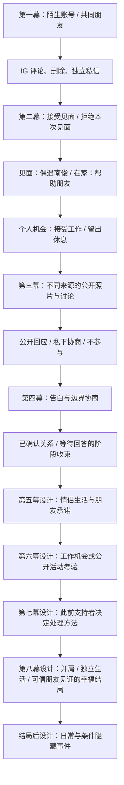

# 预设分支版：制作范围与完整因果设计

独立分支，未发布。原站和旧存档不改。第一阶段可玩范围为第一至第四幕；第五至八幕仅为明确标注的后续设计，运行时不会出现占位章节。

## 八幕依赖图

六线：A 关系，B 秘密，C 舆论，D 朋友，E 个人生活，F 日常细节。第一阶段每条线都有实际内容，但不声称完成六条长期线的全部高潮。

关键差异：接受见面才可能遇见南俊，拒绝不会触发偶遇；拒约后可帮助朋友或独自休息，只有帮过朋友才有主动代查公开照片的帮助；接工作后具体日期需改约，休息则保留原约；公开回应增加可见度，私下沟通减少围观，忽略讨论不会自动视为信任不足；回忆初始“无糖”细节解锁专属饮料回应。旧决定保存在 flags 和选择历史中，汇合节点按这些决定呈现不同已发生事实。

独立可选支线：书妍的展览邀请可先处理或后处理；个人生活机会与恋爱消息并存。人物不知道未向其公开的秘密。

节点的 ID、故事线、前置条件、对白、选项、后果、后续事件和跨 App 内容以 story-data.mjs 为可执行事实来源；生成的 NODE-LIST.md 为审阅清单。
