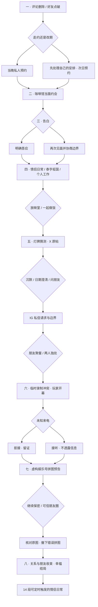

# 八幕因果图 · 已实现的紧凑主线

全部为架空成年角色的虚构私人事件。节点内选择改变实际事件、公开内容和长期变量。主线从暧昧开始，第三幕明确确认，后半段保留情侣生活。

- 不赴聚餐，不会出现露台上泰亨的表露或柾国厨房对话。
- 不公开澄清，不会凭空生成玩家澄清帖。
- 拒接来电，不会执行接听中对方的对白。
- 改期保留 declined 和专属消息；之后见面明确是改过的预约。
- 工作/帮朋友/休息、隐私策略、可信朋友圈和重要早期记忆保存在 flags/choices，结局有对应差异。
- 主线的完整收束发生在 r-finale。旧第一阶段的 checkpoint 现为继续点，不删除其选择历史。
- 手机通知指向先存储的内容，跨 App 不依赖实时生成；App 顶部或浮动的继续入口避免盲找。
